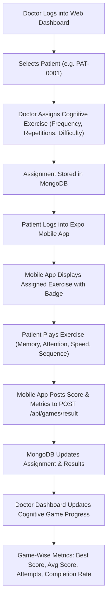

# AlzCare: Alzheimer MRI Detection & Cognitive Care Platform

AlzCare is an integrated, end-to-end clinical healthcare ecosystem designed to help neurologists and geriatricians diagnose Alzheimer's Disease stages using brain MRI scan analysis and empower patient rehabilitation through targeted cognitive exercises.

The ecosystem connects a **Doctor Web Dashboard** (`/frontend`), an **Express REST API Backend** (`/backend`), a **FastAPI Machine Learning Service** (`/ml_service`), and a dedicated **Patient Mobile Application** (`/patient-app`) — all unified by a shared MongoDB database.

---

## 1. System Architecture Overview

```
                      +--------------------------------------------------+
                      |       Doctor Web Dashboard (Next.js :3000)       |
                      +-----------------------+--------------------------+
                                              |
                                              v (HTTP/REST + JWT)
+------------------------------------+        |        +------------------------------------+
|  Patient Mobile App (React Native) |--------+------->|  Backend Express (Node.js @ :5000) |
+------------------------------------+                 +--------+--------------------+------+
                                                                |                    |
                                           MongoDB Queries      |                    |  FastAPI (MRI Analysis)
                                                                v                    v
                                                       +--------+--------+   +---------------+------+
                                                       |  MongoDB Local  |   |  ML Service (FastAPI |
                                                       |  (:27017)       |   |  @ Port 8000)        |
                                                       +-----------------+   +----------------------+
```

### Key Components:
1. **Doctor Web Dashboard (`/frontend`):** Built with **Next.js 16 (App Router), React 19, and Tailwind CSS**. Doctors register patients, assign cognitive exercises with custom difficulty/frequency, review MRI scan predictions, and monitor real-time patient cognitive progress.
2. **Patient Mobile App (`/patient-app`):** Built with **React Native and Expo (TypeScript)**. Specially crafted for Alzheimer's patients with large touch targets, accessible typography, high-contrast dark theme, interactive cognitive games (Memory Match, Visual Search, Speed Tap, Pattern Sequence), appointment scheduling, and care notifications.
3. **Backend (`/backend`):** **Express.js and Node.js** REST API server connected to **MongoDB**. Shares data in real time across the Doctor Web Dashboard and Patient Mobile App without data duplication.
4. **ML Service (`/ml_service`):** A **Python FastAPI** server that processes brain MRI scans using MobileNetV2.

---

## 2. Interactive End-to-End Workflow



---

## 3. Database Schema Models (MongoDB)

All schemas are defined under `/backend/models`:

* **Doctor (`Doctor.js`):** Name, email, password (bcrypt), specialization, status.
* **Patient (`Patient.js`):** Name, email, password, age, gender, patientId (`PAT-XXXX`), assigned doctor reference, phone, address, emergency contact, medical history.
* **GameAssignment (`GameAssignment.js`):** `patientId`, `doctorId`, `gameName`, `difficulty`, `status` (`Assigned` | `Completed`), `frequency` (Daily, Weekly, Once), `repetitions`, `startDate`, `dueDate`, `notes`.
* **GameResult (`GameResult.js`):** `assignmentId`, `patientId`, `gameName`, `difficulty`, `score`, `accuracy`, `timeTaken`, `moves`, `completionDate`.
* **Appointment (`Appointment.js`):** `patientId`, `doctorId`, `date`, `timeSlot`, `reason`, `status` (`Scheduled`, `Confirmed`, `Completed`, `Cancelled`).
* **Notification (`Notification.js`):** Clinical alerts, assignment notices, and appointment reminders.
* **MriReport (`MriReport.js`):** MRI Record ID, patient reference, file path, AI stage prediction, and confidence score.

---

## 4. API Endpoints Map

### Authentication & Profiles
* `POST /api/auth/login` - Authenticate Doctors, Patients, and Admins (Returns JWT).
* `GET /api/auth/me` - Get current authenticated user details.
* `GET /api/patients/me` - Get authenticated patient's profile and medical history.
* `GET /api/patients/me/doctor` - Get patient's assigned physician profile.

### Cognitive Exercises & Progress
* `GET /api/games/catalog` - Complete list of cognitive exercises with clinical descriptions.
* `GET /api/patients/me/games` - Patient exercises merged with live assignment status & personal stats.
* `POST /api/games/result` - Submit patient game completion result (score, accuracy, timeTaken, moves).
* `GET /api/patients/me/game-progress` - Comprehensive progress summary for mobile patient.
* `POST /api/doctors/patients/:patientId/games` - Doctor assigns game to patient with frequency and repetitions.
* `GET /api/doctors/patients/:patientId/game-progress` - Doctor views patient game-wise metrics and history.

### Appointments
* `GET /api/patients/me/appointments` - Patient retrieves scheduled & past appointments.
* `POST /api/appointments` - Book/request consultation with physician.

---

## 5. Local Setup & Execution Guide

### Prerequisites
* **Node.js** (v18.x or newer) and **npm**
* **MongoDB** (Local instance running at `mongodb://127.0.0.1:27017`)
* **Python** (v3.9 - v3.11) with pip
* **Expo Go App** (on Android or iOS phone)

---

### Step 1: Start MongoDB
Ensure MongoDB is running locally:
```bash
# Windows Services
net start MongoDB
# Or run mongod directly
mongod --dbpath <path-to-data-directory>
```

---

### Step 2: Backend Setup & Execution
```bash
cd backend
npm install
npm run dev
```
*Backend runs on `http://localhost:5000` (and `http://192.168.1.5:5000` on your local network)*

---

### Step 3: Frontend (Doctor Web Dashboard) Setup & Execution
```bash
cd frontend
npm install
npm run dev
```
*Doctor & Patient Web Portal runs on `http://localhost:3000`*

---

### Step 4: Patient Mobile App (React Native + Expo) Setup & Execution
```bash
cd patient-app
npm install
npx expo start
```
- Connect your phone and computer to the same Wi-Fi.
- Open the **Expo Go** app on your Android device and scan the terminal QR code.
- Or press `a` to run in Android Emulator, or `w` to run in browser.

---

### Step 5: (Optional) ML Service Setup & Execution
```bash
cd ml_service

# Create virtual environment (optional)
python -m venv .venv
.venv\Scripts\activate

pip install -r requirements.txt
python app.py
```
*ML Service runs on `http://localhost:8000`*

---

## 6. End-to-End Verification Test

To verify the complete 14-step integration test automatically:
```bash
cd backend
node test_e2e_full.js
```
This tests:
1. Doctor login
2. Doctor selects patient
3. Doctor assigns game (Memory Match)
4. Database saves assignment
5. Patient logs into mobile app
6. Patient mobile app receives game
7. Patient plays game
8. Patient completes game
9. Database saves score & metrics
10. Patient mobile app shows updated progress
11. Doctor refreshes patient profile
12. Doctor web dashboard displays updated game-wise analytics
13. Patient opens appointments
14. Patient sees doctor appointment data

---

## 7. Project Directory Structure

```
alzheimer-mri-detection/
├── backend/                  # Node.js & Express REST API Server
│   ├── config/               # Database connection
│   ├── controllers/          # Business logic (games, patients, appointments, auth)
│   ├── middleware/           # Role verification & JWT auth
│   ├── models/               # Mongoose schemas (Doctor, Patient, GameAssignment, GameResult, etc.)
│   ├── routes/               # API route definitions (games, doctors, patients, appointments)
│   ├── test_e2e_full.js      # Automated 14-step end-to-end integration test
│   └── server.js
├── frontend/                 # Doctor & Patient Web Dashboard (Next.js 16 + React 19)
│   ├── src/app/              # Next.js App Router pages
│   │   ├── (doctor)/         # Doctor Dashboard & Cognitive Game Progress views
│   │   └── (patient)/        # Patient Web Portal
├── patient-app/              # Dedicated Patient Mobile Application (React Native + Expo)
│   ├── src/
│   │   ├── components/       # Accessible UI elements (Card, Button, Badge, Header, EmptyState)
│   │   ├── constants/        # Cognitive care dark theme & typography
│   │   ├── context/          # AuthContext with patient role enforcement
│   │   ├── games/            # Cognitive exercises (MemoryMatch, VisualSearch, SpeedTap, PatternSequence)
│   │   ├── navigation/       # Bottom tabs & stack navigators
│   │   ├── screens/          # Splash, Login, Dashboard, Games, GamePlay, Progress, Appointments, DoctorInfo, Profile, Notifications
│   │   ├── services/         # Axios API client & AsyncStorage session manager
│   │   └── types/            # TypeScript interfaces
│   ├── App.tsx               # Root entry point with providers
│   ├── app.json              # Expo configuration
│   └── README.md             # Mobile app documentation
├── ml_service/               # Python FastAPI Machine Learning Microservice
└── README.md                 # Master project documentation
```
